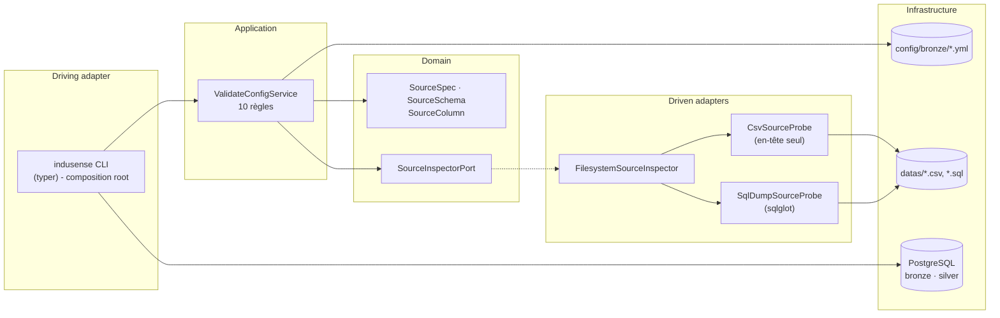

# INGESTION PROCESS — couche BRONZE (contrat v2)

> **État d'implémentation** : les lots S1 (socle), S2 (contrat et validation) et S3 (chargement)
> sont **livrés et testés**. `make bronze` charge les quatre sources et `make bronze` rejoué ne
> duplique rien. 200 tests, dont 24 d'intégration PostgreSQL. La couche silver reste à faire (S4).
>
> Ce document décrit le contrat **tel qu'il est implémenté**, pas une intention. Chaque garantie
> ci-dessous renvoie à un test qui la vérifie (§8).

---

## 1. Ce qu'est le bronze

Le bronze reçoit les fichiers sources **tels quels**. Aucune transformation métier : ni fusion, ni
nettoyage, ni dédoublonnage, ni calcul de tendance. Il fait trois choses :

1. stocker la valeur d'origine,
2. ajouter les colonnes techniques de traçabilité,
3. déclarer les opérations que la couche silver devra exécuter.

### Principes

| Principe | Ce que cela veut dire concrètement |
|---|---|
| **Aucune perte** | Chaque colonne source produit un miroir `TEXT` (`<col>_raw`) *et* une colonne typée calculée au mieux ([ADR-002](adr/002-doctrine-bronze.md)) |
| **Déclaratif** | Tout est piloté par `config/bronze/*.yml` ; aucune liste de colonnes en dur dans le code |
| **Traçable** | Chaque ligne porte son fichier, son hash, son numéro de ligne et son lot |
| **Idempotent** | Rejouer une ingestion ne duplique rien : l'unicité est portée par la base, pas par une convention applicative |
| **Vérifié avant d'écrire** | La configuration est confrontée au **fichier réel** avant toute lecture ou écriture |
| **DDL revue** | Les changements de schéma passent par une migration Alembic, jamais par un `CREATE TABLE` implicite |

---

## 2. Le contrat : `config/bronze/*.yml`

### Organisation des bases dans le parcours Nuxt/API

Le parcours applicatif utilise **une base par modèle**. Son schéma par défaut est
`versionning` : versions du modèle, événements et transitions de statut, exécutions durables,
lots et métriques d'ingestion. Les données sont isolées dans un schéma par couche et numéro
de version : `"1-bronze"`, `"2-bronze"`, puis `"1-silver"`, `"1-gold"` lorsque ces étapes
seront implémentées. Le contrat conserve la cible logique `bronze` ; la migration approuvée
affiche sa destination physique exacte. Le parcours CLI historique conserve le schéma `bronze`.

Dans chaque schéma Bronze, `_ingestion_receipts` scelle les chargements et
`_ingestion_errors` conserve les lignes non insérées après rollback : batch ID, empreintes
du fichier et du contrat, table, numéro de ligne, données brutes et diagnostic. Ces logs sont
écrits dans une transaction indépendante. Les anomalies de cast qui restent sous le seuil
sont conservées dans les données et dans `_cast_errors`, sans rejet de la ligne.

L'étape 3 confirme les cartes d'identité et prépare la migration. L'étape 4 affiche son SQL
pour revue humaine ; **Approuver et lancer le chargement** applique le DDL puis ingère les
sources. L'interface suit les phases réelles de l'exécution avec l'animation du robot qui
transporte les papiers vers le scanner et son tapis roulant. Une reconnexion retrouve
l'exécution en cours. Après interruption du serveur, la demande persistée est rejouée avec
les mêmes révisions ; les sceaux empêchent une réinsertion des données déjà chargées.

L'étape 5 comporte **Rapport d'ingestion** (métriques, lots, diagnostics et dictionnaire) et
**Revue** (structure et contenu paginé de toutes les tables du schéma Bronze sélectionné,
logs compris, en lecture seule). **Valider le bronze dataset** vérifie les sceaux et les
rapports avant de faire passer la version à `ingestion-silver`. Les bases historiques
séparées par version restent consultables ; aucune relocalisation automatique de leurs données.

Le catalogue de contrôle conserve également la file d'exécution et les journaux : les échecs
précédant la création de la base du modèle restent ainsi observables. Ces informations sont
réconciliées dans `versionning` après création et à la fin des traitements.

Schéma de validation : [`config/schema/bronze.v2.schema.json`](../config/schema/bronze.v2.schema.json).
Quatre configurations, une par table cible :

| Fichier | Source | Table cible | Lignes attendues |
|---|---|---|---|
| `telemetry.yml` | `datas/telemetry.csv` | `bronze.telemetry` | 135 626 |
| `releves_incidents.yml` | `datas/releves_incidents.csv` | `bronze.releves_incidents` | 1 245 |
| `machine.yml` | `datas/machine.sql` (table `machine`) | `bronze.machine` | 15 |
| `maintenance.yml` | `datas/machine.sql` (table `maintenance`) | `bronze.maintenance` | 115 |

### Clés

| Clé | Requis | Rôle |
|---|---|---|
| `version` | oui | Version du contrat (`x.y.z`) |
| `kind` | oui | Toujours `BRONZE` |
| `timezone` | oui | Horloge déclarée de la source. Seule valeur acceptée : `UTC` ([ADR-003](adr/003-fuseau-horaire.md)). **Étiquetée, jamais convertie** |
| `source.path` | oui | Chemin du fichier source, résolu depuis la racine du projet |
| `source.format` | oui | `CSV` ou `SQL` |
| `source.encoding` | oui | Encodage **explicite**. L'auto-détection a été supprimée : elle produisait du mojibake sur les accents |
| `source.field_delimiter` | CSV | Séparateur de champs (1 caractère) |
| `source.row_delimiter` | CSV | `\n` ou `\r\n` |
| `source.has_header` | CSV | Toujours `true` : le bronze a besoin de colonnes nommées |
| `source.table` | SQL | Table à extraire du dump |
| `target.schema` | oui | Toujours `bronze` |
| `target.table` | oui | Table cible. **Unicité vérifiée entre configurations** |
| `target.natural_key` | oui | Clé métier, exprimée en `target_name`. Remplace l'heuristique « première colonne `IDENTIFIER` », qui élisait `machine_id` comme clé primaire de `telemetry` |
| `max_cast_error_ratio` | non | Part maximale de lignes portant ≥ 1 erreur de cast. `0.0` sur les quatre configs |
| `columns[]` | oui | Une entrée par colonne source (voir ci-dessous) |
| `derived_columns[]` | non | Opérations à exécuter **en silver**, déclarées ici comme contrat |

### `columns[]`

| Clé | Requis | Rôle |
|---|---|---|
| `source_name` | oui | Nom de colonne **dans le fichier**. Vérifié contre le fichier réel |
| `target_name` | oui | Nom de colonne dans le bronze |
| `type` | oui | Type data-science (`IDENTIFIER`, `NUMBER`, `BINARY`, `TIMESTAMPTZ`…) |
| `silver_type` | oui | Type PostgreSQL visé en silver. Ex-`sql_type`, renommé : il ne décrit **pas** un DDL bronze |
| `unit` | pour `NUMBER` | Unité de mesure (`CELSIUS`, `BAR`, `VOLT`, `RPM`, `HOUR`, `UTC`) |
| `nullable` | non | Attente métier, reprise par les contraintes silver |
| `description` | non | Documentation |

### `derived_columns[]`

| Clé | Requis | Rôle |
|---|---|---|
| `target_name` | oui | Colonne produite **en silver** |
| `operation` | oui | `MERGE`, `NORM`, `STD`, `ENC`, `ANO`, `DEL`, `IMP`, `OUT` |
| `operate_on_columns` | oui | `target_name` d'entrée ; au moins 2 pour `MERGE` |
| `silver_type` | oui | Type de la colonne produite |

> **Le point important** : `date_time` (fusion de `date` et `time` des incidents) n'existe **pas** en
> bronze. Le bronze stocke `date` et `time` séparément, tels quels ; la fusion est une opération
> silver, déclarée ici et exécutée là-bas. L'ancien contrat créait une colonne vide « en attente »,
> ce qui revenait à stocker un mensonge.

---

## 3. Ce que la validation garantit

`indusense bronze validate` s'exécute **avant** toute lecture ou écriture. Il retourne la liste
complète des problèmes, avec un pointeur vers la cellule fautive — pas la première erreur rencontrée.

| # | Règle | Exemple de rejet |
|---|---|---|
| 1 | Conformité au JSON Schema | `timezone: 'Europe/Paris'` → seule la valeur `UTC` est acceptée |
| 2 | Unicité des `target_name` (colonnes + dérivées) | `duplicate target_name 'dt' (already used at columns[0].target_name)` |
| 3 | `operate_on_columns` référence une colonne déclarée | `'nowhere' is not a declared target_name in columns` |
| 4 | Collision des miroirs `<target>_raw` | `physical column name 'machine_id_raw' collides with columns[0].target_name` |
| 5 | `natural_key` référence des colonnes déclarées | `target.natural_key[0]: 'ghost' is not a declared target_name` |
| 6 | Compatibilité `type` ↔ `silver_type` | `'TIMESTAMP' is not compatible with type 'TIMESTAMPTZ'` |
| 7 | `source_name` **existe dans le fichier** | `column 'duration_hour' does not exist in machine.sql:maintenance. Did you mean 'duration_hours'?` |
| 8 | `source_name` **est réellement fourni par les données** | `column 'is_active' exists in the DDL of machine.sql:machine but is never provided by the INSERT` |
| 9 | La table SQL contient des lignes | `machine.sql:ghost has no INSERT: no data to ingest` |
| 10 | Deux configurations n'écrivent pas la même table | `bronze.telemetry is already produced by telemetry.yml` |

Les règles 7 et 8 sont celles qui rattrapent les erreurs réelles du dépôt : `duration_hour` au lieu de
`duration_hours`, et `is_active` / `created_at` / `updated_at` présentes au `CREATE TABLE` mais
absentes de l'`INSERT` (leurs valeurs viendraient d'un `DEFAULT`, donc d'un élément qui **n'est pas
dans le fichier**).

---

## 4. Déroulé

### Étape 0 — Charger la configuration

Lecture YAML. Une erreur de syntaxe est rapportée avec sa ligne et sa colonne.

### Étape 1 — Valider (avant toute lecture de données)

Les dix règles du §3. Une configuration invalide arrête tout : rien n'est lu, rien n'est écrit.

### Étape 2 — Décrire la source

| Format | Méthode | Coût |
|---|---|---|
| CSV | Lecture du seul en-tête (`csv` de la stdlib), BOM retiré, doublons détectés | O(1) |
| SQL | Parsing complet avec **`sqlglot`** (jamais d'expression régulière) : `CREATE TABLE` pour les colonnes déclarées, `INSERT` pour les colonnes réellement fournies et le nombre de lignes | O(taille du dump) |

Le dump n'est **jamais exécuté**. Aucune table temporaire, aucune connexion à la base cible.

> Pourquoi un vrai parseur : l'implémentation précédente lisait `VALUES (...)` avec une regex qui
> s'arrêtait à la première parenthèse fermante, soit **1 ligne sur 130** — 98,5 % des données
> perdues silencieusement.

### Étape 3 — Construire le schéma bronze

Pour chaque entrée de `columns[]`, **deux** colonnes SQL (ADR-002) :

```sql
-- valeur d'origine, intacte
temperature_raw  TEXT,
-- valeur typée, calculée au mieux : NULL si le cast échoue
temperature      DOUBLE PRECISION,
```

Plus, sur chaque table :

| Colonne | Rôle |
|---|---|
| `_batch_id` | Identifiant du lot d'ingestion (UUID) |
| `_source_file` | Chemin du fichier source |
| `_source_hash` | SHA-256 **des octets** du fichier |
| `_row_number` | Numéro de ligne dans la source |
| `_ingested_at` | Horodatage d'ingestion |
| `_cast_errors` | `JSONB` : `{"temperature": "not a number: 'n/a'"}` ; `{}` si tout est bon |

Et la clé primaire, qui rend l'idempotence vraie **au niveau de la base** :

```sql
PRIMARY KEY (_source_hash, _row_number)
```

`_cast_errors` distingue deux états que l'ancien contrat confondait :

| Situation | `<col>_raw` | `<col>` | `_cast_errors` |
|---|---|---|---|
| Valeur présente et convertible | valeur brute | valeur typée | — |
| Valeur source vide | `''` | `NULL` | — (une absence n'est pas une erreur) |
| Valeur non convertible | valeur brute | `NULL` | clé présente avec le motif |

### Étape 4 — Appliquer les changements de schéma (Alembic)

1. Comparer la métadonnée SQLAlchemy à la base.
2. **Générer** le script de migration, ne pas l'appliquer en silence.
3. Revue humaine, en particulier pour les opérations destructrices.
4. Appliquer.

`alembic.ini` ne contient **aucun identifiant** : l'URL vient de `.env` via `indusense.settings`.

### Étape 5 — Charger

Lecture **en flux** (la mémoire ne dépend pas de la taille du fichier), cast au mieux, écriture des
deux colonnes par lots de 5 000 lignes, `ON CONFLICT DO NOTHING` sur la clé primaire.

Une seule transaction par configuration. Si la part de lignes en erreur de cast dépasse
`max_cast_error_ratio`, **tout est annulé** : mieux vaut une table vide qu'une table à moitié
chargée. Le registre, lui, est écrit dans des transactions séparées pour que l'échec soit conservé.

Résultat mesuré sur `./datas` : 135 626 + 1 245 + 15 + 115 lignes chargées en ~6 s, **0 erreur de
cast**, 894 `NULL` typés correspondant exactement aux 894 valeurs vides de la source.

### Étape 6 — Rapport et dictionnaire de données

Deux artefacts, dans `artifacts/` :

- le **rapport d'ingestion** : volumes, lignes en erreur de cast, statut du lot ;
- le **dictionnaire de données** : une entrée par colonne (`source_name`, `target_name`,
  `raw_column`, `type`, `unit`, `silver_type`, `cast_failures`, `null_rate`, `min`, `max`) plus la
  section `derived_columns`.

**Exigence** : les deux portent une section `transformations` obligatoire, qui dit *ce qui
a été fait à la donnée*, pas seulement *combien de lignes* :

```jsonc
{ "code": "MERGE", "target": "date_time", "source": ["date", "time"],
  "detail": "concaténation 'date time', horloge UTC déclarée, aucune conversion appliquée" }
```

Un rapport sans cette section est invalide, pas incomplet.

---

## 5. Architecture

Ce qui existe (S1 + S2) et ce qui arrive avec S3 :



Points d'architecture tenus :

- le **domaine ne connaît aucune infrastructure** : `SourceSpec`/`SourceSchema` sont des value
  objects, le port est un `Protocol` ;
- les **adaptateurs ne sont pas importés en cascade** : `import indusense` ne charge ni driver ni
  parseur ;
- la **composition** est uniquement dans `cli.py` ;
- les **erreurs de source sont des valeurs** : l'adaptateur lève `SourceInspectionError`, le service
  la convertit en `ValidationIssue` localisée. Valider ne doit jamais produire une trace.

---

## 6. Hors périmètre (couches suivantes)

- Exécuter les `derived_columns` (fusion `date` + `time`, normalisation du `comment`, anonymisation
  des opérateurs) : **silver**.
- Dédoublonnage des 1 340 heures dupliquées, imputation des 2 847 cellules nulles, traitement des
  aberrants : **silver**.
- Features, labels, split temporel : **gold** ([ADR-001](adr/001-definition-arret-machine.md)).
- Tout contrôle de qualité métier (27,4 % d'heures au-dessus de la capacité machine déclarée) :
  arbitrage silver, pas bronze.

---

## 7. Ce que ce document ne promet pas

| Ancienne promesse (v1) | Statut v2 |
|---|---|
| « Only the minimal type casting is applied; any failing row goes to the rejects » | **remplacée** : toute valeur est conservée en `_raw`, le cast est best-effort, les échecs sont consignés par ligne dans `_cast_errors` |
| Colonne `date_time` vide en attente dans le bronze | **supprimée** : elle n'existe qu'en silver |
| `sql_type` décrit le DDL bronze | **renommée** `silver_type` : elle décrit la cible silver |
| « Missing columns are a blocking error » | **tenu et étendu** : l'existence *et* la fourniture effective par les données sont vérifiées |

---

## 8. Traçabilité : chaque promesse a son test

| Garantie | Test |
|---|---|
| Les 4 configs valident contre les 4 sources réelles | `tests/test_validate_config.py::test_repository_configs_are_valid` |
| Volumes exacts des 4 tables | `tests/test_ingestion_integration.py::test_row_counts` |
| `<col>_raw` identique à la source, colonne entière | `::test_raw_column_is_identical_to_the_source` |
| `NULL` typé ⟺ source vide | `::test_typed_null_means_blank_source` |
| `_cast_errors` vide sur le jeu de référence | `::test_cast_errors_are_empty_on_the_reference_dataset` |
| Rejeu sans doublon | `::test_replaying_duplicates_nothing` |
| Dépassement du seuil → rollback complet | `::test_cast_error_beyond_threshold_rolls_back` |
| Le CSV gère guillemets et retours à la ligne | `tests/test_readers.py::test_quoted_newline_stays_in_the_value` |
| Le dump SQL est lu intégralement (130 lignes) | `tests/test_readers.py::test_both_tables_of_the_dump_are_read_completely` |
| Une colonne inexistante est rejetée en nommant colonne et fichier | `test_unknown_column_names_column_and_file` |
| Une colonne DDL sans `INSERT` est rejetée | `test_ddl_only_column_is_rejected_with_an_actionable_message` |
| Les en-têtes CSV sont exacts (7 et 18 colonnes) | `tests/test_source_probes.py::test_telemetry_header_is_exact`, `::test_incidents_header_is_exact` |
| Le dump SQL est lu **intégralement** (130 lignes) | `test_multi_row_insert_is_fully_read` |
| Les valeurs contenant `,` et `(` sont correctement parsées | `test_insert_values_containing_separators_are_parsed` |
| Deux configs ne peuvent pas écrire la même table | `test_two_configs_cannot_write_the_same_table` |
| Le contrat v1 ne passe plus | `test_v1_keys_are_rejected` |
| L'horloge est déclarée UTC | `test_non_utc_timezone_is_rejected` |
