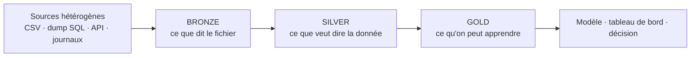
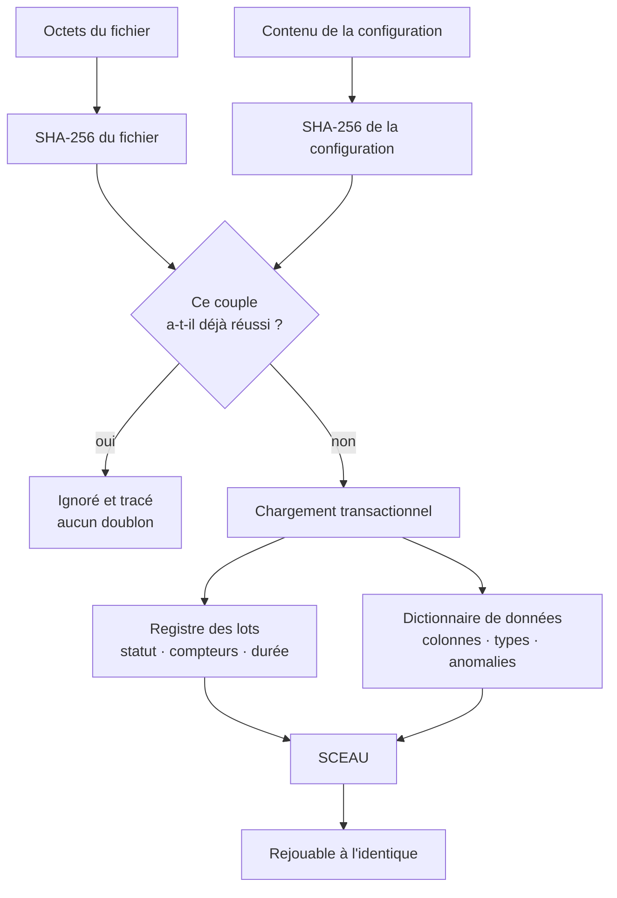
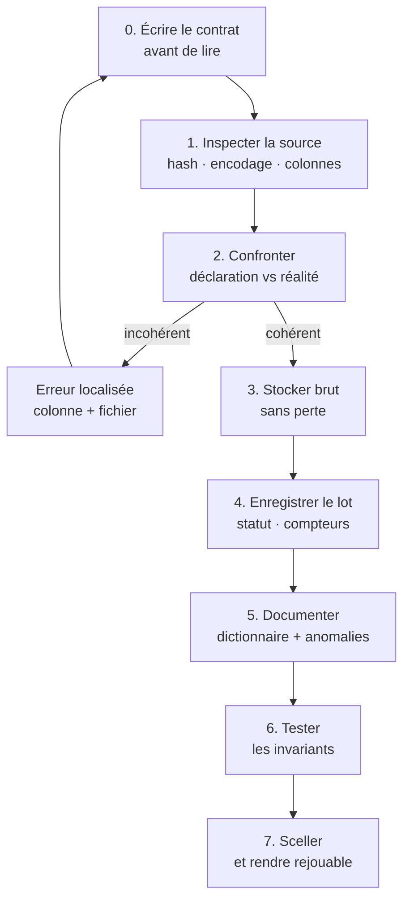
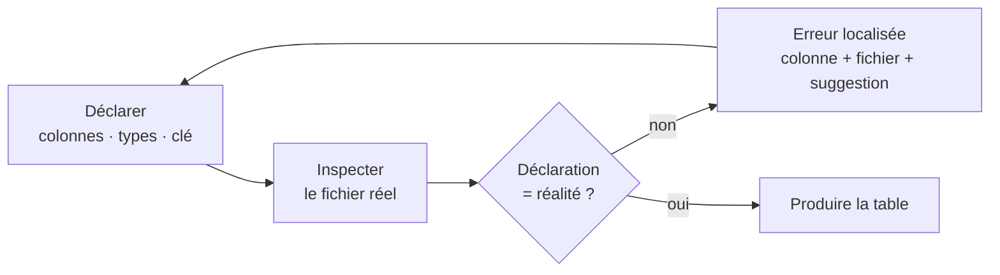
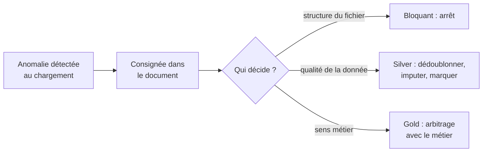
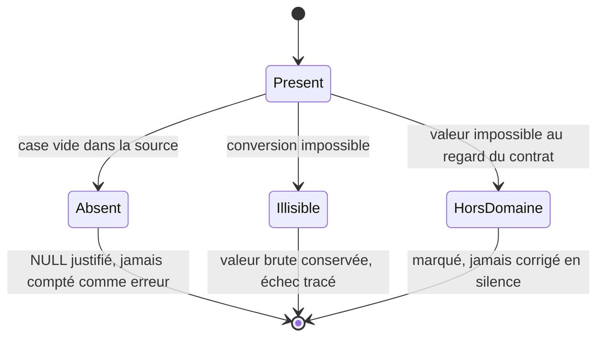
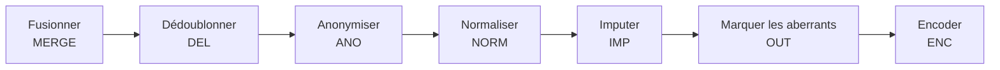
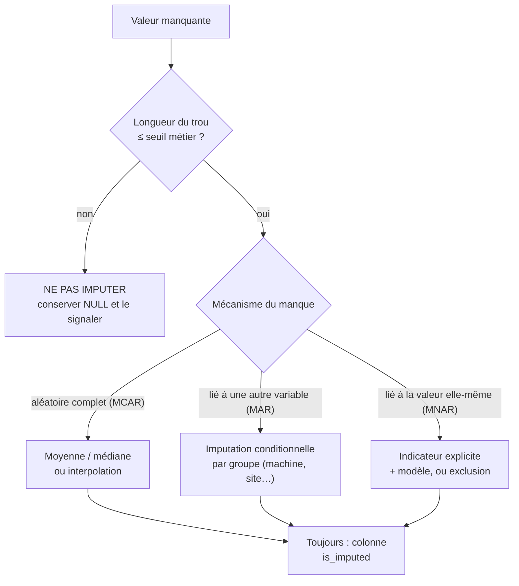
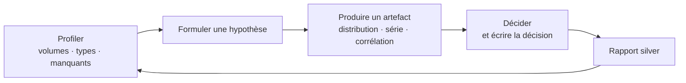
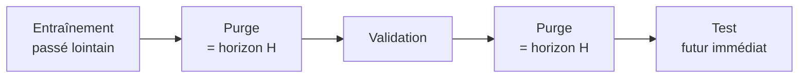

# Guide — Ingérer des données proprement, de la source au dataset d'entraînement

> **À qui s'adresse ce document** : étudiants en data science, ingénieurs qui reprennent un
> pipeline existant, toute personne qui doit répondre un jour à la question
> *« d'où vient ce chiffre ? »* devant un client.
>
> **Ce que vous saurez faire à la fin** : concevoir une chaîne d'ingestion que vous pouvez
> **prouver**, transformer des données sans en inventer, produire les artefacts d'analyse qui
> mènent à un dataset d'entraînement défendable, et dialoguer avec un métier sur une base chiffrée.
>
> Ce guide est **indépendant de tout projet** : les exemples sont génériques. Une étude de cas
> appliquée est signalée en fin de document.

---

## 1. Le problème réel

Trois échecs reviennent dans presque tous les projets de données. Aucun ne lève d'erreur.

**Échec 1 — la perte silencieuse.** Un extracteur lit `INSERT INTO t (a, b) VALUES (1, 'x'), (2, 'y')`
avec une expression régulière qui s'arrête à la première parenthèse fermante. Il retourne une ligne
au lieu de deux. Personne ne s'en aperçoit : le tableau de bord s'affiche, le modèle s'entraîne, les
chiffres sont juste deux fois trop petits.

**Échec 2 — le faux vert.** Un script de validation attrape l'exception de validation et l'affiche
comme un succès. Il annonce « 5/5 configurations valides » sur des fichiers qui se contredisent. Le
seul garde-fou du projet certifie l'inverse de la vérité.

**Échec 3 — la donnée fabriquée.** Un trou de 16 heures est comblé par interpolation linéaire. Le
modèle apprend une rampe parfaitement lisse, qui ressemble à une vraie dérive physique. On ne
découvre le problème qu'après avoir présenté le résultat.

> **La règle à retenir**
> Une chaîne de données ne se juge pas à ce qu'elle produit, mais à **ce qu'elle permet de prouver**.

---

## 2. Le principe : trois couches, une seule direction



| Couche | Question à laquelle elle répond | Ce qu'on y a droit | Ce qui est interdit |
|---|---|---|---|
| **Bronze** | *Que dit le fichier, exactement ?* | recopier, horodater, hacher, signaler | convertir, corriger, filtrer |
| **Silver** | *Que veulent dire ces valeurs ?* | dédoublonner, normaliser, imputer, anonymiser | entraîner, sélectionner des variables |
| **Gold** | *Que peut-on apprendre, à quel prix d'erreur ?* | agréger, décaler, encoder, découper | revenir à la source sans repasser par le bronze |

**La direction est unique.** Le bronze ne connaît pas le silver ; le silver ne connaît pas le modèle.
Si une correction est nécessaire en amont, on **reconstruit** la couche aval — on ne la rafistole pas
sur place. C'est ce qui rend une erreur corrigeable : il suffit de rejouer.

> **Une idée qui change la façon de travailler** : considérez le bronze comme une **porte à sens
> unique**.
> Tout ce qui entre est conservé ; tout ce qui est en aval est reconstructible. Une chaîne où l'on
> peut tout reconstruire se répare ; une chaîne où l'on a écrasé la source se regrette.

---

## 3. Le sceau : ce qui distingue une ingestion « propre »

Une ingestion est **scellée** quand vous pouvez répondre à quatre questions, sans faire confiance à
personne :

1. **Quels octets ?** — l'empreinte (hash) du fichier source, calculée sur les octets, pas sur le
   texte décodé.
2. **Quelle recette ?** — l'empreinte de la configuration utilisée, pas son numéro de version (une
   version peut changer sans que le contenu change, et l'inverse).
3. **Qu'est-ce qui a été fait ?** — un rapport qui énumère les transformations appliquées, en clair.
4. **Puis-je refaire ?** — rejouer la même ingestion redonne exactement le même résultat, sans
   doublon.



### Les trois pièces du sceau

| Pièce | Rôle | Ce qui casse sans elle |
|---|---|---|
| **Clé d'unicité en base** | `(hash_fichier, numéro_de_ligne)` en clé primaire | un rejeu duplique les lignes |
| **Registre des lots** | une ligne par tentative, avec statut et compteurs | impossible de savoir si l'échec d'hier a été rejoué |
| **Dictionnaire de données** | colonnes, types, taux de valeurs absentes, min/max, anomalies | la couche aval découvre les problèmes trop tard |

> **Le détail qui compte** : l'idempotence doit être portée par une **contrainte de base**, pas par un
> `if hash in deja_vus` dans le code. Un `if` se contourne (exécution partielle, base restaurée,
> script lancé à la main) ; une clé primaire ne se contourne pas.

---

## 4. La méthode en huit étapes



### Étape 0 — Écrire le contrat avant de lire

On déclare ce qu'on **attend** : les colonnes, leur type cible, l'unité, la clé métier, l'encodage,
le format. Écrire le contrat d'abord est ce qui donne au reste de la valeur : on ne peut pas
confronter une réalité à une déclaration qui n'existe pas.

### Étape 1 — Inspecter la source

Trois informations coûtent presque rien et évitent la majorité des surprises :

| À mesurer | Pourquoi |
|---|---|
| **Hash des octets** | identité du fichier ; deux contenus décodés identiques peuvent différer |
| **Encodage réel** | un UTF-8 lu en latin-1 produit du mojibake invisible dans les agrégats |
| **Liste des colonnes réellement présentes** | le seul moyen de détecter une colonne renommée en amont |

### Étape 2 — Confronter déclaration et réalité

C'est **l'étape que la plupart des pipelines sautent**, et c'est celle qui attrape les vraies erreurs.
Une colonne déclarée absente du fichier doit être une **erreur bloquante nommant la colonne et le
fichier** — pas un `NULL` silencieux.



Trois cas doivent être distingués, avec trois messages différents :

| Cas | Message attendu |
|---|---|
| Colonne inconnue | `colonne 'X' absente du fichier. Vouliez-vous dire 'Y' ?` |
| Colonne déclarée mais jamais alimentée | `'X' existe au schéma mais aucune ligne ne la fournit` |
| Fichier sans données | `la table ne contient aucune ligne à ingérer` |

### Étape 3 — Stocker brut, sans perte

Deux doctrines s'opposent ; il faut choisir consciemment.

| | **Bronze 100 % texte** | **Bronze hybride** |
|---|---|---|
| Perte d'information | nulle | nulle |
| Interrogeable typé | non | oui |
| Nombre de colonnes | ×1 | **×2** (`<col>_raw` + `<col>`) |
| Valeur non convertible | reste lisible | reste lisible *et* l'échec est tracé par ligne |

Le choix importe moins que sa documentation. Ce qui est **non négociable**, c'est que la valeur
d'origine soit toujours consultable : une conversion qui écrase la source est une perte définitive.

### Étape 4 — Enregistrer le lot

Le registre répond à *« qu'est-ce qui s'est passé le 3 mars à 14 h ? »* : statut, nombre de lignes
lues, chargées, en erreur, durée. C'est aussi ce qui rend l'idempotence observable.

### Étape 5 — Documenter, y compris et surtout les anomalies

Un dictionnaire de données qui ne contient que les colonnes est un inventaire, pas un contrat. Il
doit porter :

- les volumes réels et les taux de valeurs absentes **calculés** ;
- les **anomalies perceptibles**, explicitement nommées, avec la couche qui doit les traiter.



Exemple de règle saine : *« 1 340 clés métier apparaissent plusieurs fois, soit 1 346 lignes en trop.
Les lignes sont **conservées** en bronze ; le dédoublonnage est une transformation silver. »*
L'anomalie est **visible**, la décision est **attribuée**, et le bronze reste intact.

### Étape 6 — Tester les invariants, pas le code

Un bon test d'ingestion ne vérifie pas « la fonction retourne une liste ». Il vérifie une **propriété
de la donnée** :

| Invariant | Formulation |
|---|---|
| Volume | « 135 626 lignes en entrée, 135 626 en base » |
| Fidélité | « la colonne brute est identique à la source, valeur pour valeur » |
| Complétude | « toute valeur convertie à `NULL` correspond à une valeur absente de la source » |
| Idempotence | « rejouer ne change aucun compteur » |
| Seuil | « au-delà de 1 % d'échecs de conversion, tout est annulé » |

Ces tests-là cassent quand la donnée change de forme. C'est exactement ce qu'on veut : ce sont les
seuls qui protègent.

### Étape 7 — Sceller et rendre rejouable

Une chaîne scellée se reconstruit **depuis les fichiers et les configurations**, à l'identique, sur
une machine neuve, sans intervention manuelle. Si reconstruire demande « d'aller voir la base de
temps en temps », ce n'est pas reconstruire.

---

## 5. Les quatre états d'une valeur

Une grande partie des bugs de données vient de la **confusion entre quatre états** qu'un tableur
affiche de la même façon.



| État | Signification | Traitement correct | Traitement fautif |
|---|---|---|---|
| **Présent** | la valeur existe et se convertit | conversion | — |
| **Absent** | la source n'a rien envoyé | `NULL`, aucune erreur | imputer sans le dire |
| **Illisible** | la source a envoyé quelque chose d'inconvertible | `NULL` typé + valeur brute + motif | jeter la ligne |
| **Hors domaine** | la valeur est possible techniquement mais impossible métier | marquer, alerter | corriger en silence |

> **La distinction la plus rentable** : *absent* ≠ *illisible*. Un capteur qui n'envoie rien et un
> capteur qui envoie `n/a` racontent deux histoires différentes sur le matériel. Les confondre, c'est
> jeter l'information qui permet de diagnostiquer.

---

## 6. Silver — transformer sans mentir

Le silver applique un **enchaînement ordonné** de transformations. L'ordre n'est pas cosmétique :
dédoublonner avant d'imputer évite d'interpoler à travers un doublon ; imputer avant de marquer les
aberrants évite de déclarer aberrant une valeur qu'on vient d'inventer.



### 6.1 Déduplication

Deux familles, à ne pas confondre :

| Type | Définition | Détection |
|---|---|---|
| **Doublon strict** | toutes les colonnes identiques | comparaison ligne à ligne |
| **Doublon de clé** | même clé métier, valeurs différentes | regroupement par clé |

Le second est le piège : les valeurs diffèrent **légèrement** (bruit de mesure), donc aucun outil ne
les signale comme doublons. Il faut alors **choisir un agrégateur**, et ce choix se documente :

| Stratégie | Quand elle est défendable | Quand elle ne l'est pas |
|---|---|---|
| `first` / `last` | jamais seule | dépend de l'ordre physique du fichier : non déterministe par la donnée |
| `min` / `max` | grandeur où l'extrême est l'information (pic de pression) | fabrique des extrêmes qui n'existent pas |
| `moyenne` | plusieurs mesures du même instant (± bruit) | moyenne des valeurs qui n'ont pas la même nature |
| `somme` | quantités additives (pièces produites sur des sous-périodes) | **double comptage** si les lignes sont deux mesures de la même période |

> **Méthode** : avant de choisir, mesurez. Si la dispersion intra-groupe est très inférieure à la
> variabilité du signal, la moyenne est le choix non biaisé. Si elle est comparable, les lignes ne
> mesurent pas la même chose et il faut un arbitrage métier.

**Conservez toujours un compteur** du nombre de mesures agrégées. Effacer cette information est une
perte définitive, alors qu'elle coûte une colonne entière.

### 6.2 Fusion et dérivation

Une date et une heure séparées, un prénom et un nom, un code postal et une ville : ce sont des
**colonnes dérivées**, pas des corrections. Deux règles :

1. Une dérivation **ajoute** une colonne, elle n'écrase pas les sources.
2. Une dérivation qui dépend du temps doit **déclarer son horloge** (voir §6.8).

### 6.3 Normalisation et standardisation

Deux opérations différentes, souvent confondues.

| | **Normalisation** (min-max) | **Standardisation** (z-score) |
|---|---|---|
| Formule | `(x - min) / (max - min)` | `(x - moyenne) / écart-type` |
| Résultat | dans `[0, 1]` | moyenne 0, écart-type 1 |
| Sensible aux extrêmes | **oui**, fortement | oui, mais moins |
| À utiliser quand | bornes connues, réseau de neurones | distributions approximativement gaussiennes, régression régularisée |

**Piège majeur** : les paramètres (`min`, `max`, `moyenne`, `écart-type`) se calculent sur le **jeu
d'entraînement uniquement**, puis s'appliquent tels quels au test. Les recalculer sur l'ensemble est
une fuite d'information — le modèle aurait vu la distribution du futur.

### 6.4 Anonymisation

Un nom, un badge, un identifiant client sont des **données personnelles**. Le hachage salé est un
bon compromis : irréversible, mais **stable** — le même individu garde le même pseudonyme, ce qui
préserve l'usage analytique (compter les interventions par opérateur).

| Règle | Raison |
|---|---|
| Le sel ne va **jamais** dans le dépôt | sans sel, un hachage de noms se casse par dictionnaire en quelques secondes |
| Sel vide = **refus de démarrer** | une erreur silencieuse ici est une fuite de données personnelles |
| Le hachage est **stable** | sinon le champ perd toute utilité analytique |
| Documentez la durée de conservation | l'anonymisation ne dispense pas du RGPD |

### 6.5 Imputation

**Imputer** = remplir une valeur manquante. C'est l'opération la plus dangereuse du silver, parce
qu'elle **fabrique de la donnée**.



**Les trois mécanismes du manque** (à connaître, c'est le cœur du sujet) :

| Mécanisme | Signification | Exemple | Conséquence |
|---|---|---|---|
| **MCAR** | manque purement aléatoire | capteur qui redémarre au hasard | l'imputation simple est peu biaisée |
| **MAR** | manque lié à une **autre** variable observée | capteur en panne seulement sur les machines anciennes | imputer **par groupe** |
| **MNAR** | manque lié à la **valeur elle-même** | le capteur sature et n'écrit rien au-delà de 80 °C | aucun modèle simple ne corrige ; il faut un indicateur |

**Les méthodes, du plus simple au plus coûteux :**

| Méthode | Coût | Quand | Danger |
|---|---|---|---|
| `NULL` conservé | nul | arbres de décision, gradient boosting | aucun |
| Moyenne / médiane | nul | MCAR, faible taux | écrase la variance |
| Report de la dernière valeur | nul | séries lentes, état persistant | fige une tendance |
| Interpolation linéaire | faible | trous **courts** sur une série régulière | invente une rampe lisse |
| Imputation par groupe | moyen | MAR | nécessite des groupes assez grands |
| Imputation par modèle | élevé | MNAR, enjeu fort | fuite si le modèle voit la cible |

**Le critère décisif est la longueur du trou, pas le taux global.** Un taux de 2 % de valeurs
absentes peut cacher 300 trous de 1 heure (imputables) ou 30 trous de 10 heures (à ne pas toucher).
**Mesurez la distribution des longueurs avant d'écrire la règle.**

> **La règle d'or** : *une valeur imputée non signalée est pire qu'une valeur manquante.* Le modèle
> apprendra à reconnaître l'imputation au lieu du phénomène. La colonne `is_imputed` n'est pas un
> luxe, c'est la condition pour que l'imputation soit défendable.

### 6.6 Aberrants

Un **aberrant** (*outlier*) est une valeur très éloignée du reste de la distribution. Ce n'est **pas**
forcément une erreur — c'est souvent l'information la plus intéressante du fichier.

| Méthode | Principe | Robustesse | Quand |
|---|---|---|---|
| **IQR** | hors `[Q1 − k·IQR, Q3 + k·IQR]`, `k` ≈ 1,5 à 3 | bonne | distributions asymétriques, défaut raisonnable |
| **z-score** | `abs(z) > 3` | faible (masqué par les extrêmes) | distribution gaussienne |
| **MAD** | écart absolu médian | très bonne | données très polluées |
| **Isolation Forest** | isolement par arbres aléatoires | bonne | multidimensionnel |

**Trois distinctions à ne jamais perdre :**

1. **Aberrant statistique ≠ erreur.** Une machine qui surchauffe produit une valeur aberrante *vraie*.
2. **Aberrant local ≠ aberrant global.** Une température normale pour une machine, anormale pour une
   autre : calculez **par groupe**.
3. **Marquer ≠ supprimer.** Supprimer un aberrant revient à supprimer le signal qu'on cherche.

| Traitement | Quand |
|---|---|
| **Marquer** (`_outliers`) et laisser | par défaut — préserve l'information |
| Plafonner (*winsorisation*) | distributions à queue lourde, modèle sensible |
| Transformer (log) | relation multiplicative, asymétrie forte |
| Supprimer | **uniquement** après confirmation d'une erreur de saisie |

### 6.7 Encodage des variables catégorielles

Un modèle calcule ; il lui faut des nombres. Encoder, c'est choisir **comment** traduire une modalité
en nombre — et ce choix n'est jamais neutre.

**One-hot encoding** : une colonne binaire par modalité.

```
couleur = rouge | vert | bleu
        ↓
couleur_rouge  couleur_vert  couleur_bleu
      1              0             0
      0              1             0
```

| Avantage | Limite |
|---|---|
| aucune relation d'ordre inventée | **explosion du nombre de colonnes** |
| interprétable | inutilisable au-delà de quelques dizaines de modalités |
| compatible avec tous les modèles | colonnes creuses → mémoire et temps |

**Le piège du dummy** (*dummy variable trap*) : avec `k` modalités, la `k`-ième colonne est
**redondante** (somme des colonnes = 1). Sur une régression linéaire avec intercept, cela rend la
matrice singulière. Solution : supprimer une modalité de référence (`drop_first`, ou
`OneHotEncoder(drop="first")`).

**Les alternatives, à connaître avant de foncer sur le one-hot :**

| Méthode | Idée | Quand |
|---|---|---|
| **Ordinal** | `LOW < MEDIUM < HIGH` → `1, 2, 3` | l'ordre est réel et signifiant |
| **Fréquence** | remplacer la modalité par son effectif | cardinalité élevée, peu de signal |
| **Target encoding** | moyenne de la cible par modalité | cardinalité très élevée — **à calculer avec validation croisée**, sinon fuite |
| **Hashing** | hacher la modalité vers `n` colonnes fixes | flux, cardinalité inconnue |
| **Embedding** | vecteur appris | deep learning, très forte cardinalité |

**Seuils pratiques** : one-hot jusqu'à ~10-20 modalités ; au-delà, regrouper les modalités rares en
`AUTRE`, ou changer de méthode.

> **Où encoder ?** Dans le **gold**, pas dans le silver. Un one-hot fige la liste des modalités dans
> le schéma : chaque nouvelle valeur en production demanderait une migration. Encoder est du
> *feature engineering*, pas de la normalisation.

### 6.8 Les pièges transverses du silver

| Sujet | Le piège | La règle |
|---|---|---|
| **Encodage de fichier** | UTF-8 lu en latin-1 → accents cassés, agrégats faux | **déclarer** l'encodage, jamais le deviner ; refuser en cas d'échec |
| **BOM** | `\ufeff` invisible devant le premier nom de colonne | le retirer explicitement |
| **Fuseau horaire** | deux sources à deux horloges → jointure décalée | **déclarer** l'horloge et **ne jamais convertir** ; tester l'hypothèse sur les cycles d'activité |
| **Unités** | `bar` contre `psi`, `°C` contre `°F` | déclarer l'unité dans le contrat, la porter dans le dictionnaire |
| **Casse et espaces** | `LOW`, `low`, `LOW ` → trois modalités | normaliser, et **compter** les valeurs modifiées |
| **Ordre des lignes** | `first`/`last` dépendent du fichier | trier explicitement, ou choisir un agrégateur indépendant de l'ordre |

---

## 7. Silver — les artefacts d'analyse

Transformer sans regarder est un aveuglement organisé. Avant de construire le gold, **produisez des
artefacts** : ils coûtent peu, se joignent à un rapport, et déclenchent des décisions.



### Catalogue d'artefacts

| Artefact | Comment | Ce qu'il révèle | Décision qu'il déclenche |
|---|---|---|---|
| **Distribution** (histogramme, densité) | par variable numérique | asymétrie, multimodalité, bornes suspectes | transformer (log), ou changer de métrique |
| **Carte des manquants** | matrice lignes × colonnes, ou taux par colonne | manques structurés (blocs) ou dispersés | imputer ou non ; identifier une panne capteur |
| **Boîte à moustaches par groupe** | par machine, site, période | décalage entre groupes | normaliser par groupe |
| **Série temporelle par entité** | une courbe par entité | dérives lentes, ruptures, saisonnalité | définir les fenêtres glissantes |
| **Matrice de corrélation** | Pearson **et** Spearman | redondance entre variables, relations non linéaires | supprimer une variable redondante |
| **Tableau de cardinalité** | nombre de modalités par catégorielle | colonne à 500 modalités, ou constante | encoder, regrouper, supprimer |
| **Taux de positifs par catégorie** | cible moyenne par modalité | segment sur-représenté | stratifier, ou contrôler le biais |
| **Profil des doublons** | groupes, taille, dispersion intra-groupe | doublons stricts vs bruit de mesure | choisir l'agrégateur |
| **Tableau des violations** | valeurs hors bornes métier | incohérence référentiel / mesure | arbitrage métier |
| **Autocorrélation** | ACF par entité | mémoire du processus | choisir la profondeur des décalages |

### Trois conseils d'interprétation

1. **Pearson n'est pas la vérité.** Il ne mesure que les relations **linéaires** et il est écrasé par
   les extrêmes. Tracez toujours le nuage de points avant de conclure à une corrélation.
2. **Une corrélation n'est pas une cause, ni une feature.** Deux variables corrélées peuvent être
   deux mesures du même phénomène : garder les deux n'ajoute pas d'information et dilue l'importance.
3. **Regardez la cible avant les features.** Le taux d'événements, sa répartition dans le temps et
   par segment déterminent la faisabilité du problème, bien avant le choix du modèle.

---

## 8. Gold — construire la vérité terrain

Le gold répond à une seule question : *« qu'est-ce qu'un exemple, et qu'est-ce qu'une réponse
correcte ? »*. Tant que ce n'est pas écrit, tout le reste est décoratif.

### 8.1 Définir la cible avant les features

Une cible doit être **un événement observable, daté, et non ambigu**. Les quatre questions :

1. **Quoi ?** quel événement exactement ? (une intervention non planifiée ? un arrêt ? une alarme ?)
2. **Où ?** à quelle entité s'applique-t-il ? (machine, ligne, produit)
3. **Quand ?** à quel instant est-il *connu*, et à quel instant est-il *prédictible* ?
4. **Combien ?** combien d'occurrences dans l'historique ? (si le compte est inférieur à ~50, la
   puissance statistique est faible et il faut le dire)

| Définition candidate | Positifs | Avantage | Risque |
|---|---|---|---|
| Intervention non planifiée | 25 | événement coûteux, daté, tracé | dépend du remplissage du référentiel |
| Arrêt d'urgence déclaré | 19 | proche de l'intuition métier | déclaratif, subjectif |
| Sévérité élevée | 205 | volume confortable | inclut des alarmes **sans** arrêt |

> **Le piège le plus fréquent** : choisir la définition qui donne le plus de positifs, parce qu'elle
> « marche mieux ». Ce n'est plus de la science, c'est du réglage de métrique. La définition se
> décide avec le métier, se **documente**, et ne change plus sans un nouvel accord écrit.

### 8.2 Le grain et l'horizon

| Notion | Question | Exemple |
|---|---|---|
| **Grain** | une ligne = quoi ? | une machine et une heure |
| **Horizon** | on prédit à quel délai ? | 6 h, 12 h, 24 h |
| **Fenêtre** | sur quelle durée regarde-t-on le passé ? | 24 h de mesures glissantes |

L'horizon n'est pas un détail technique : c'est une **contrainte métier**. Prédire 1 heure avant une
panne laisse trop peu de temps pour organiser une intervention ; prédire 72 heures produit trop de
fausses alertes.

### 8.3 La fuite d'information

Une **fuite** (*leakage*) est l'utilisation, pour prédire, d'une information qui ne serait pas
disponible au moment de la décision. C'est la première cause de modèle « excellent en test, inutile
en production ».

**Trois fuites classiques :**

| Fuite | Mécanisme | Symptôme |
|---|---|---|
| **Temporelle** | découpage aléatoire au lieu de chronologique | score de test irréaliste |
| **De bord de fenêtre** | une alerte à `t−1 h` prédit un événement à `t+6 h`, déjà connu de la fenêtre voisine | rappel anormalement élevé |
| **De cible** | une variable contient la conséquence de l'événement | importance écrasante d'une seule variable |

Le découpage temporel correct comporte une **purge** de la durée de l'horizon :



Sans purge, la dernière fenêtre d'entraînement contient déjà l'information de la première fenêtre de
test : le modèle « voit l'avenir » par un chevauchement de quelques heures.

### 8.4 Les features du gold

Trois familles, toutes **causales** (aucune information postérieure à l'instant de décision) :

| Famille | Exemples | Intention |
|---|---|---|
| **Instantané** | valeur courante des capteurs, indicateurs de manque | état présent |
| **Tendance** | delta à `t−1 h`, pente sur 6 h / 24 h | capter une dérive lente |
| **Contexte** | heures depuis la dernière intervention, cumul de production, nombre d'incidents récents | situer la mesure dans son histoire |

> **Le piège du contexte** : les interventions *planifiées* remettent le matériel à neuf. Sans
> variable « heures depuis la dernière maintenance », le modèle apprendra *« après une intervention,
> pas de panne »* — vrai, mais sans valeur prédictive.

---

## 9. Gold — les insights et le document qui parle au métier

Un dataset d'entraînement n'est pas un livrable : c'est un **support de conversation**. Le livrable
est un document que le métier lit, comprend, conteste — et signe.

### 9.1 Les insights à dégager

| Insight | Question | Pourquoi c'est décisif |
|---|---|---|
| **Taux d'événements** | combien d'événements pour combien de lignes ? | fixe la métrique et la difficulté réelle |
| **Délai de détection** | combien d'heures avant l'événement le signal devient visible ? | détermine l'horizon utile |
| **Séparabilité** | la distribution d'une variable diffère-t-elle avant/normal ? | dit si le problème est apprenable |
| **Segments** | quelles entités concentrent les événements ? | évite d'apprendre un identifiant au lieu d'un signal |
| **Stabilité** | les distributions changent-elles entre périodes ? | conditionne la validité dans le temps |
| **Coût des erreurs** | combien coûte un faux positif ? un faux négatif ? | fixe le seuil de décision |
| **Baseline** | que ferait une règle simple ? | sans baseline, aucun modèle ne se justifie |

### 9.2 La fiche dataset (le document à faire signer)

```markdown
# Fiche dataset — <nom>

## 1. Question métier
Quelle décision cela sert-il, et qui la prend ?

## 2. Définition de la cible
Événement retenu, source, période, nombre d'occurrences.
Définitions écartées, et pourquoi.

## 3. Périmètre
Grain, période couverte, entités incluses et exclues.

## 4. Volumes
Lignes, colonnes, taux de positifs, répartition dans le temps.

## 5. Variables
Liste, type, unité, taux de manquants, source.

## 6. Transformations subies
Renvoi au rapport silver : dédoublonnage, imputation, marquage.

## 7. Limites connues
Biais, trous non imputés, définitions fragiles, événements rares.

## 8. Découpage
Train / validation / test, avec dates et purge.

## 9. Métrique et point de fonctionnement
Métrique choisie, budget de fausses alertes, justification.

## 10. Décisions à valider
Points ouverts, avec l'impact chiffré de chaque option.
```

### 9.3 Comment mener la conversation avec le métier

| Ce que vous montrez | Ce que vous demandez |
|---|---|
| Le taux d'événements et sa répartition | « est-ce le bon événement ? en manque-t-il ? » |
| Le délai de détection observé | « est-ce assez tôt pour agir ? » |
| La courbe précision/rappel au point retenu | « préférez-vous 2 alertes par semaine ou 2 pannes ratées ? » |
| La liste des événements détectés et manqués | « ces manqués sont-ils acceptables ? » |
| La baseline par règle simple | « votre expertise fait-elle mieux que cette règle ? » |

> **Ne montrez jamais une précision globale.** Sur un taux d'événements de 1 %, un modèle qui prédit
> toujours « rien » atteint 99 %. Annoncez le **rappel à budget d'alertes fixé** : c'est la seule
> formulation qui ait un sens opérationnel.

---

## 10. Les dix pièges, et leur correctif

| # | Piège | Symptôme | Correctif |
|---|---|---|---|
| 1 | **Faux vert** : le validateur attrape l'erreur et l'affiche comme un succès | tout est toujours « valide » | ne jamais transformer une erreur en information |
| 2 | **Perte silencieuse** : extracteur qui lit une ligne sur cent trente | volumes trop ronds, chute inexpliquée | compter les lignes et comparer à l'attendu |
| 3 | **Décoder au hasard** : encodage deviné | mojibake, accents disparus | déclarer l'encodage ; refuser en cas d'échec |
| 4 | **Convertir** un fuseau horaire au lieu de le déclarer | jointures décalées de 1-2 h | déclarer l'horloge, ne jamais convertir |
| 5 | **Imputer pour faire joli** | taux de manquants artificiellement nul | mesurer la longueur des trous, marquer chaque imputation |
| 6 | **Supprimer les aberrants** | modèle lisse, pouvoir prédictif faible | marquer, ne pas supprimer |
| 7 | **Fuite de cible** | score de test spectaculaire | vérifier chaque variable contre la chronologie |
| 8 | **Découpage aléatoire** sur une série temporelle | test irréaliste | découper en blocs + purge |
| 9 | **Métrique inadaptée** | « 99 % de précision » | rappel à budget d'alertes, PR-AUC |
| 10 | **Métrique falsifiée** : régler un paramètre pour retrouver le chiffre annoncé | le résultat colle au plan | documenter l'écart ; c'est le résultat qui commande le plan |

---

## 11. Checklist finale

**Contrat**
- [ ] Chaque colonne est déclarée : nom source, nom cible, type, unité, obligatoire ou non
- [ ] La clé métier est explicite (pas déduite d'une heuristique)
- [ ] L'encodage et l'horloge sont déclarés, pas devinés

**Bronze**
- [ ] Hash des octets calculé et stocké
- [ ] La valeur brute est consultable pour toute ligne
- [ ] Clé primaire = hash du fichier + numéro de ligne
- [ ] Rejeu sans doublon, vérifié par test

**Documentation**
- [ ] Volumes, taux de manquants, min/max **calculés**
- [ ] Anomalies nommées, avec la couche responsable de la décision
- [ ] Rapport de transformation en clair, pas seulement des compteurs

**Silver**
- [ ] Ordre des transformations fixé et documenté
- [ ] Doublons : stratégie choisie **sur mesure**, compteur conservé
- [ ] Imputation : longueur des trous mesurée avant la règle ; indicateur présent
- [ ] Aberrants : marqués, jamais supprimés
- [ ] Données personnelles : hachage salé, sel hors dépôt, refus si sel vide
- [ ] Artefacts produits : distributions, manquants, corrélations, séries

**Gold**
- [ ] Cible définie avec le métier, datée, non ambiguë
- [ ] Grain et horizon écrits
- [ ] Taux d'événements connu et communiqué
- [ ] Découpage temporel avec purge
- [ ] Baseline simple mesurée
- [ ] Métrique adaptée au déséquilibre
- [ ] Fiche dataset rédigée et **signée**

**Sceau**
- [ ] Reconstruire depuis les fichiers donne le même résultat
- [ ] Les tests portent sur des invariants de données, pas sur du code
- [ ] Un lecteur externe peut refaire le chemin sans vous appeler

---

## 12. Exercices

**Exercice 1 — la perte silencieuse.** Prenez un fichier de 10 000 lignes. Écrivez deux extracteurs :
l'un qui découpe sur le séparateur de champs, l'autre qui utilise un analyseur CSV. Comparez les
volumes. *Question* : comment détecter la perte sans connaître le bon résultat ?

**Exercice 2 — le doublon invisible.** Dans un jeu de séries temporelles, trouvez les clés qui
apparaissent plusieurs fois. Mesurez la dispersion intra-groupe. *Question* : la moyenne est-elle
défendable, ou les lignes mesurent-elles deux choses différentes ?

**Exercice 3 — imputer ou pas.** Sur un jeu avec des valeurs manquantes, calculez la distribution des
longueurs de trous. *Question* : quel seuil choisiriez-vous, et que coûterait un seuil deux fois plus
grand ? Combien de valeurs auriez-vous fabriquées ?

**Exercice 4 — le piège du dummy.** Encodez une variable à 3 modalités en one-hot, puis ajustez une
régression linéaire avec intercept, sans puis avec `drop_first`. *Question* : que se passe-t-il sur
les coefficients, et pourquoi ?

**Exercice 5 — la fuite.** Construisez un découpage aléatoire puis un découpage temporel avec purge
sur une série avec événements rares. Comparez les scores. *Question* : lequel croyez-vous, et
pourquoi ?

---

## 13. Pour aller plus loin

Ce guide décrit une méthode ; il existe une **étude de cas appliquée** dans ce dépôt, où chaque
décision est tracée par un *Architecture Decision Record* :

| Décision | Où la lire |
|---|---|
| Définir la cible avant les features | `docs/adr/001-definition-arret-machine.md` |
| Doctrine du stockage brut (texte vs typé) | `docs/adr/002-doctrine-bronze.md` |
| Déclarer l'horloge, ne jamais convertir | `docs/adr/003-fuseau-horaire.md` |
| Choisir un agrégateur de dédoublonnage sur mesures | `docs/adr/004-dedoublonnage.md` |
| Politique d'imputation et refus d'imputer les trous longs | `docs/adr/008-politique-imputation.md` |

> Ces documents montrent à quoi ressemble une décision **écrite** : contexte, options chiffrées,
> choix, conséquences, et le test qui verrouille le choix. C'est le niveau de rigueur qu'on attend
> d'un travail qui sera relu dans deux ans — peut-être par vous.

> **Passer à la pratique** : une fois la méthode comprise, [DATA_INGESTION.md](DATA_INGESTION.md)
> déroule la même chaîne pas à pas, avec les outils à utiliser, les livrables attendus à chaque
> étape, et ce qui déclenche un rejeu (data drift, concept drift, nouvelles données).
