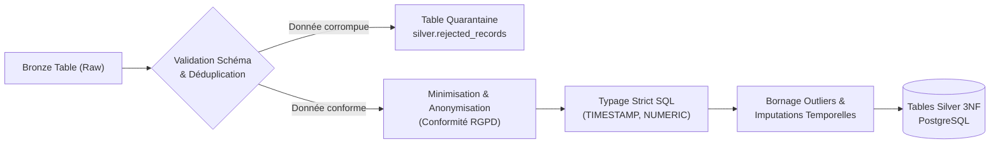
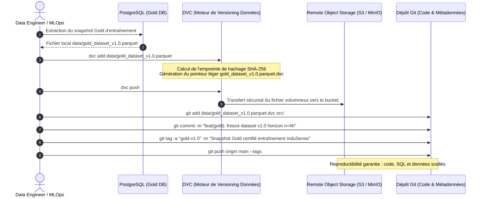

# Guide Pratique d'Ingestion & Pipeline de Données : Du Brut au Gold Dataset (Projet InduSense)

Ce document de référence décrit la démarche complète d'ingestion et de transformation des données pour le projet **InduSense**. L'objectif applicatif est de concevoir un modèle de Machine Learning supervisé (classification) capable d'anticiper à un horizon de $n$ heures un arrêt machine non planifié à partir de flux de capteurs industriels, de relevés d'incidents et de données de maintenance.

---

## 1. Vue d'ensemble de l'architecture Medallion

L'architecture repose sur le paradigme **Medallion** (Bronze $\rightarrow$ Silver $\rightarrow$ Gold) au sein d'une base de données relationnelle **PostgreSQL**, couplée à un dispositif de double versioning associant **Git** (pour le code et les métadonnées de suivi) et **DVC** (Data Version Control, pour les snapshots de jeux de données volumineux).

```mermaid
flowchart TD
    subgraph Sources ["1. Sources Brutes Hétérogènes"]
        S1["Télémétrie Capteurs IoT\n(CSV / JSON / MQTT)"]
        S2["Relevés d'Incidents\n(CSV / XML)"]
        S3["Fiches Machines & Maintenance\n(CSV / ERP)"]
    end

    subgraph Bronze ["2. Palier Bronze (Données Brutes Immuables)"]
        B1[("bronze.raw_telemetry\n+ métadonnées ingestion")]
        B2[("bronze.raw_incidents\n+ métadonnées ingestion")]
        B3[("bronze.raw_machines\n+ métadonnées ingestion")]
        B_audit[("bronze.ingestion_batches_log\n(traçabilité & checksums)")]
    end

    subgraph Silver ["3. Palier Silver (Nettoyé, Typé & Conforme)"]
        V1["Validation Schéma & Déduplication"]
        V2["Anonymisation PII & Conformité RGPD"]
        V3["Traitement Outliers & Imputations"]
        S_tbl[("Tables 3NF PostgreSQL :\nsilver.telemetry\nsilver.incidents\nsilver.machines")]
    end

    subgraph Gold ["4. Palier Gold (Feature Store & Cible ML)"]
        G1["Alignement Temporel & Fenêtrage (Rolling stats)"]
        G2["Calcul du Label Cible (Panne à n heures)"]
        G3["Mise à l'échelle & PCA (Fit sur Train seul)"]
        G_tbl[("gold.ml_classification_features")]
    end

    subgraph Governance ["5. Gouvernance & Versioning"]
        GIT["Git (Code pipelines, SQL, fichiers pointeurs .dvc)"]
        DVC["DVC + Stockage Objets (S3 / MinIO / Stockage Local)"]
    end

    Sources -->|Ingestion idempotente & horodatée| Bronze
    Bronze -->|Transformations nettoyantes & Qualité| Silver
    Silver -->|Feature Engineering & Règle Anti-Leakage| Gold
    Gold -->|Export snapshot .parquet / .csv| DVC
    DVC -.->|Génération pointeurs sha256/md5| GIT
```



---

## 2. Palier Bronze : Ingestion et Traçabilité des Données Brutes

Le palier **Bronze** conserve la donnée brute à son état d'origine sans altération métier. Il constitue la source de vérité historique et permet de rejouer tout le pipeline en cas d'évolution des règles de calcul.

### 2.1 Documentation technique et traçabilité des lots d'ingestion
Chaque table du schéma Bronze intègre systématiquement quatre colonnes techniques de gestion :
- `_ingested_at` (`TIMESTAMP WITH TIME ZONE`) : Date et heure précises (UTC) du chargement en base.
- `_source_file` (`VARCHAR(255)`) : Nom complet ou URI du fichier source d'origine.
- `_batch_id` (`UUID`) : Identifiant unique du lot d'exécution de l'ingestion.
- `_row_checksum` (`VARCHAR(64)`) : Empreinte cryptographique SHA-256 de la ligne d'origine brute, prévenant les doublons stricts.

Une table de journalisation centralisée enregistre chaque chargement :
```sql
CREATE SCHEMA IF NOT EXISTS bronze;

CREATE TABLE bronze.ingestion_batches_log (
    batch_id UUID PRIMARY KEY,
    source_name VARCHAR(100) NOT NULL,
    source_format VARCHAR(20) NOT NULL, -- csv, json, xml, parquet
    records_read INT NOT NULL,
    records_inserted INT NOT NULL,
    records_rejected INT NOT NULL,
    status VARCHAR(20) NOT NULL, -- SUCCESS, PARTIAL, FAILED
    started_at TIMESTAMP WITH TIME ZONE NOT NULL,
    completed_at TIMESTAMP WITH TIME ZONE
);
```

### 2.2 Graphes représentatifs pour le Palier Bronze
- **Taux de complétude d'ingestion** : Histogramme à barres empilées montrant le volume de lignes insérées avec succès face aux rejets de format.
- **Latence d'ingestion** : Graphique temporel mesurant le délai entre l'instant de génération de la mesure IoT sur la machine et sa persistance en base.
- **Disponibilité du flux de télémétrie** : Heatmap visualisant l'exhaustivité des paquets horaires reçus pour chaque identifiant machine.

---

## 3. Palier Silver : Nettoyage, Conformité et Normalisation

Le palier **Silver** applique les règles de qualité de données, structure les entités sous forme relationnelle (3ème forme normale) et garantit la conformité légale.



### 3.1 Contraintes éthiques et réglementaires (RGPD & IA Act)
Les relevés d'incidents mentionnent fréquemment des informations individuelles (`operator_name`, `operator_badge`).
- **Principe de minimisation (RGPD Art. 5)** : Le modèle de maintenance prédictive doit qualifier la santé mécanique de l'équipement industriel et non le rendement d'un opérateur. Les noms et matricules nominatifs sont supprimés ou anonymisés de façon irréversible à l'aide d'un hachage salé (`SHA256(badge + SALT)`). Seul l'indicateur organisationnel neutre (tel que le shift de travail : matin, après-midi, nuit) est conservé.
- **Non-discrimination (IA Act)** : L'exclusion totale des données personnelles empêche tout biais d'évaluation humaine lors du déclenchement d'alertes préventives.

### 3.2 Traitement des anomalies, outliers et imputations
- **Déduplication** : Application d'une clé primaire métier composite `(machine_code, recorded_at)` ne conservant que l'enregistrement le plus récent en cas de double transmission.
- **Bornage des valeurs aberrantes (*Clipping*)** : Les valeurs dépassant les tolérances physiques de la machine (ex. température de presse négative ou supérieure à $180^\circ\text{C}$) sont bornées aux percentiles extrêmes (1er et 99ème) ou marquées `NULL` si elles traduisent une panne transitoire de sonde.
- **Imputation temporelle** :
  - Pour les coupures brèves de télémétrie ($\le 30$ minutes) : interpolation linéaire ou reconduction de la dernière valeur observée (*Forward Fill*).
  - Pour les arrêts prolongés ($> 30$ minutes) : aucune imputation n'est effectuée pour éviter de créer de faux signaux d'activité pendant une machine à l'arrêt.

### 3.3 Graphes représentatifs pour le Palier Silver
- **Boîtes à moustaches (Boxplots)** : Comparaison des variables physiques (vibrations, températures, pressions) avant et après application des règles de bornage.
- **Matrice des valeurs manquantes** : Graphique matriciel indiquant le pourcentage de valeurs nulles restantes par colonne et par unité de production.
- **Distributions empiriques (KDE / Histogrammes)** : Validation du profil statistique des grandeurs continues pour s'assurer du respect des lois physiques attendues.

---

## 4. Palier Gold : Protocole ML et Prévention du Data Leakage

Le palier **Gold** constitue la table analytique finale dénormalisée (*Feature Store*), prête pour l'apprentissage supervisé des modèles de classification.

### 4.1 Prévention stricte du Data Leakage (Fuite d'information temporelle)
Dans un contexte de prédiction de défaillance, le risque critique est l'utilisation fortuite de données postérieures au moment de la prédiction.

```mermaid
gantt
    title Construction de la fenêtre temporelle Anti-Leakage (Machine t)
    dateFormat  HH:mm
    axisFormat  %H:%M
    section Fenêtrage
    Fenêtre d'observation du passé (Calcul des Features) :active, f1, 08:00, 14:00
    Horizon tampon / Délai d'action (n heures) :crit, f2, 14:00, 16:00
    Fenêtre cible de survenue d'un incident :done, f3, 16:00, 18:00
```



1. **Calcul des prédicteurs uniquement sur le passé** : Les indicateurs statistiques (moyennes glissantes sur 6 heures, écarts-types, extrema de vibrations, nombre d'heures depuis la dernière maintenance) sont calculés strictement sur la fenêtre $[t - W, t]$.
2. **Définition de la cible ($Y$)** : La variable binaire `target_unplanned_stop` prend la valeur `1` si un arrêt machine non planifié de type correctif survient dans la fenêtre $[t + \text{buffer}, t + \text{buffer} + \text{horizon}]$, et `0` dans le cas contraire.
3. **Partitionnement chronologique strict** : Les jeux d'entraînement, de validation et de test sont séparés selon une ligne temporelle continue (ex. mois 1 à 8 pour le Train, mois 9 et 10 pour le Test). Tout découpage aléatoire (*Random K-Fold*) est formellement banni.
4. **Calcul des transformations (Normalisation & PCA)** :
   - Les objets `StandardScaler` (moyennes et variances) ainsi que les matrices de projection `PCA` sont ajustés **exclusivement sur le jeu de données d'entraînement (Train)**.
   - Les objets entraînés sont sérialisés (`scaler.pkl`, `pca.pkl`), puis appliqués tels quels sur le jeu de test et lors des inférences temps réel.

```sql
CREATE SCHEMA IF NOT EXISTS gold;

CREATE TABLE gold.ml_classification_features (
    feature_id UUID PRIMARY KEY,
    machine_code VARCHAR(50) NOT NULL,
    snapshot_time TIMESTAMP WITH TIME ZONE NOT NULL,
    -- Variables calculées sur le passé
    temp_rolling_mean_6h NUMERIC(8,2),
    temp_rolling_std_6h NUMERIC(8,2),
    vibration_peak_6h NUMERIC(8,2),
    pressure_trend_slope NUMERIC(8,4),
    hours_since_last_maintenance NUMERIC(8,2),
    -- Cible de classification
    target_unplanned_stop_4h INT NOT NULL, -- 0 ou 1
    dvc_snapshot_tag VARCHAR(50) NOT NULL
);
```

### 4.2 Graphes représentatifs pour le Palier Gold
- **Matrice de corrélation (Heatmap)** : Évaluation de la corrélation entre les nouvelles variables calculées pour éliminer la colinéarité excessive.
- **Courbe d'éboulis des valeurs propres (Scree Plot PCA)** : Visualisation du pourcentage de variance cumulée expliquée par chaque composante principale afin de justifier le nombre de composantes retenues.
- **Distribution des classes (Bar Chart)** : Mesure précise du déséquilibre entre les heures de fonctionnement nominal (classe majoritaire 0) et les situations pré-panne (classe minoritaire 1).

---

## 5. Versioning Intégré Git & DVC : Traçabilité et Reproductibilité

Le couplage de **Git** et **DVC** garantit que chaque version d'un modèle d'intelligence artificielle est rigoureusement rattachée à la version exacte des données Gold ayant servi à son entraînement.



### 5.1 Protocole opérationnel de versioning
1. **Extraction de la table Gold** :
   ```bash
   python scripts/export_gold_snapshot.py --version v1.0 --output data/gold_v1.0.parquet
   ```
2. **Ajout et indexation dans DVC** :
   ```bash
   # DVC prend en charge le fichier lourd et ajoute automatiquement sa référence dans data/.gitignore
   dvc add data/gold_v1.0.parquet
   ```
3. **Synchronisation vers le stockage d'entreprise distant** :
   ```bash
   dvc push
   ```
4. **Validation des pointeurs et balisage dans Git** :
   ```bash
   git add data/gold_v1.0.parquet.dvc data/.gitignore scripts/
   git commit -m "data(gold): enregistrement snapshot v1.0 pour classification arrêts 4h"
   git tag -a "dataset-gold-v1.0" -m "Snapshot Gold certifié pour modèle InduSense"
   git push origin main --tags
   ```

### 5.2 Synthèse comparative des paliers d'ingestion

| Palier | Données en entrée | Cible PostgreSQL | Règle Métier & Conformité | Outil de Versioning |
| :--- | :--- | :--- | :--- | :--- |
| **Bronze** | Fichiers bruts IoT, CSV, JSON, XML | `bronze.raw_*` | Immuabilité totale, contrôle d'intégrité, horodatage UTC | Logs de batchs en base de données |
| **Silver** | Données Bronze validées | `silver.*` (Format 3NF) | Typage strict, anonymisation PII (RGPD), imputation bornée | Migrations SQL (Flyway / Liquibase) & Git |
| **Gold** | Données Silver enrichies | `gold.ml_*_features` | Prévention du Data Leakage, normalisation sur Train seul | Snapshots Parquet + DVC |
| **Training** | Snapshots Gold certifiés | Modèle entraîné | Optimisation du rappel et F1-score sur arrêt imprévu | Git (Code + pointeur `.dvc`) + MLflow |

Cette méthode d'ingestion et de modélisation assure une séparation rigoureuse des responsabilités, préserve l'intégrité technique des séries temporelles industrielles et offre une garantie de reproductibilité scientifique conforme aux exigences industrielles et réglementaires.
