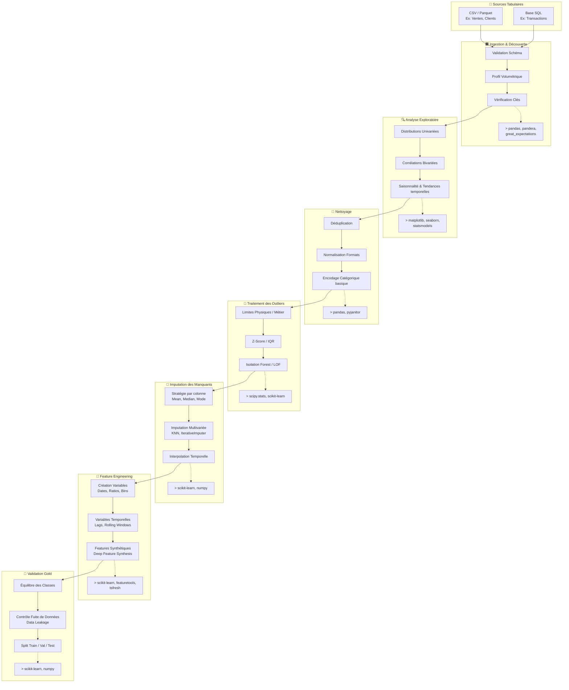

# Roadmap MLOps : Préparation d'un Dataset Tabulaire

Ce document présente les étapes essentielles pour transformer des données brutes en un dataset propre et prêt pour l'entraînement d'un modèle d'apprentissage automatique (Machine Learning). Il est destiné à vous accompagner dans la compréhension du pipeline de préparation des données.

## Architecture du Pipeline Tabulaire

## Étapes Détaillées et Librairies Python

### 1. Ingestion et Découverte
La première étape valide la structure et la volumétrie des données brutes. On s'assure que les types de colonnes (entiers, chaînes, dates) correspondent aux attentes et que les clés primaires sont uniques.
**Librairies :**
- `pandas` pour la lecture (`read_csv`, `read_parquet`, `read_sql`).
- `pandera` ou `great_expectations` pour la validation stricte de schémas (types, valeurs nulles tolérées).

### 2. Analyse Exploratoire (EDA)
L'EDA permet de comprendre la distribution des données et d'identifier les valeurs atypiques avant tout traitement. Même sur des données tabulaires, si une colonne date existe, l'analyse des tendances temporelles reste cruciale.
**Librairies :**
- `matplotlib` et `seaborn` pour les visualisations (histogrammes, boxplots, heatmaps de corrélation).
- `statsmodels` pour la décomposition des séries temporelles (saisonnalité, tendance).

### 3. Nettoyage
On harmonise les données en supprimant les doublons, en uniformisant les textes (majuscules/minuscules) et en corrigeant les types de données.
**Librairies :**
- `pandas` pour les manipulations de base (`drop_duplicates`, `.str.lower()`).
- `pyjanitor` pour enchaîner des opérations de nettoyage de manière élégante et lisible.

### 4. Traitement des Outliers
Il faut distinguer les erreurs de saisie des valeurs extrêmes légitimes. Les approches combinent des règles métier et des méthodes statistiques.
**Librairies :**
- `scipy.stats` pour les calculs de Z-score et les limites IQR.
- `scikit-learn` pour des algorithmes de détection multidimensionnelle comme `IsolationForest` ou `LocalOutlierFactor`.

### 5. Imputation des Manquants
L'absence de données est compensée par différentes stratégies selon la colonne. Les données temporelles bénéficient de méthodes spécifiques comme l'interpolation.
**Librairies :**
- `numpy` pour la gestion des `np.nan`.
- `scikit-learn.impute` pour `SimpleImputer` (moyenne, médiane) et `IterativeImputer` (modélisation des manquants via les autres colonnes).
- `pandas` pour l'interpolation temporelle (`.interpolate(method='time')`).

### 6. Feature Engineering
L'objectif est de créer de nouvelles variables pour aider le modèle. Cela inclut l'extraction d'informations des dates (jour de la semaine, mois) et la création de variables retardées (lags) si la dimension temporelle est pertinente.
**Librairies :**
- `scikit-learn.preprocessing` pour l'encodage (`OneHotEncoder`, `OrdinalEncoder`) et la mise à l'échelle (`StandardScaler`, `MinMaxScaler`).
- `featuretools` pour la génération automatique de features (Deep Feature Synthesis) croisant plusieurs tables.
- `tsfresh` pour extraire massivement des caractéristiques statistiques sur les composantes temporelles du tableau.

### 7. Validation Gold
La dernière étape prépare le split pour le Machine Learning, en s'assurant qu'aucune fuite d'information ne s'est produite depuis le futur vers le passé, et que les classes cibles sont suffisamment équilibrées.
**Librairies :**
- `scikit-learn.model_selection` pour `train_test_split` (avec l'argument `shuffle=False` si la chronologie doit être respectée).
- `imblearn` (imbalanced-learn) pour des techniques comme SMOTE si les données sont déséquilibrées.